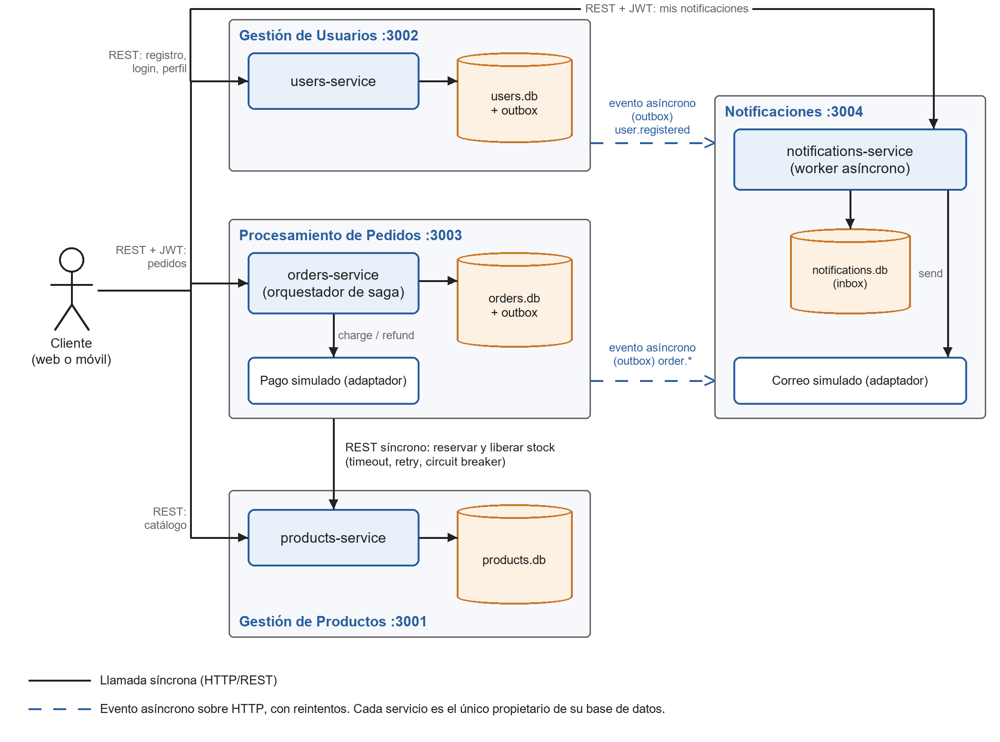
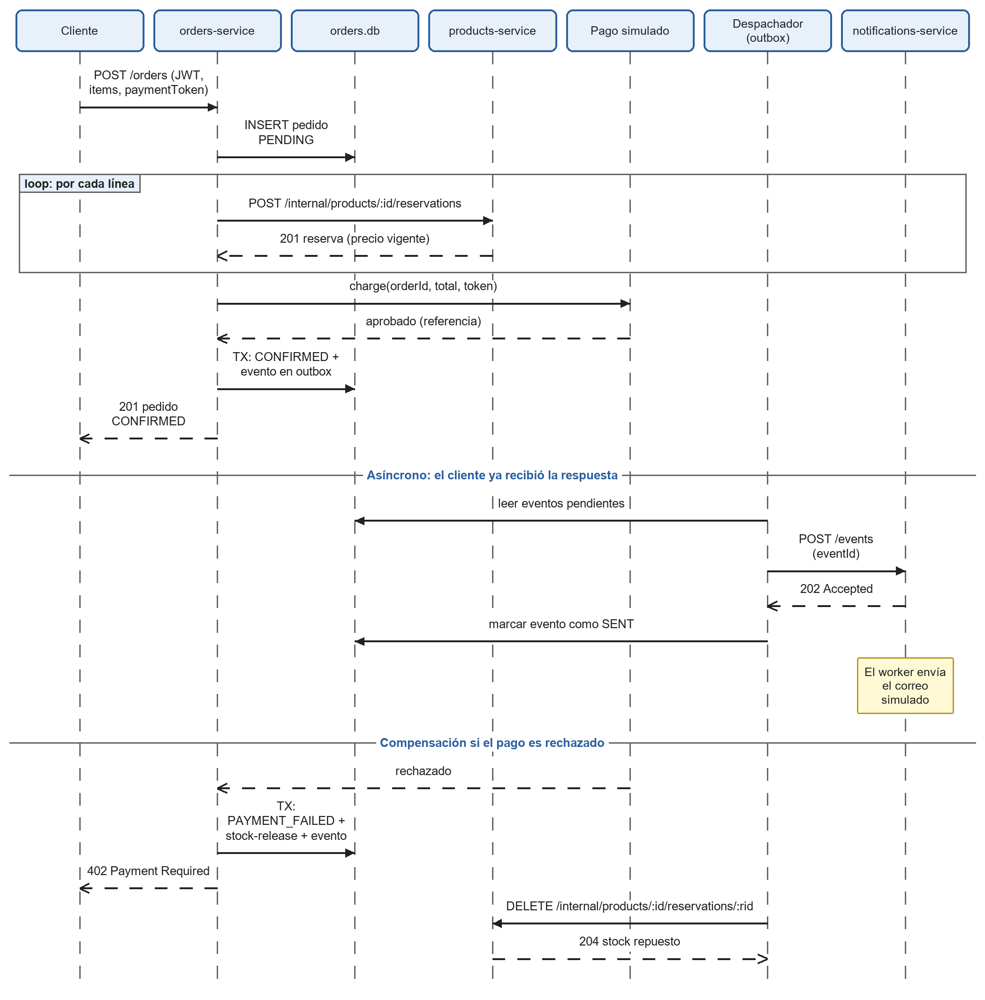
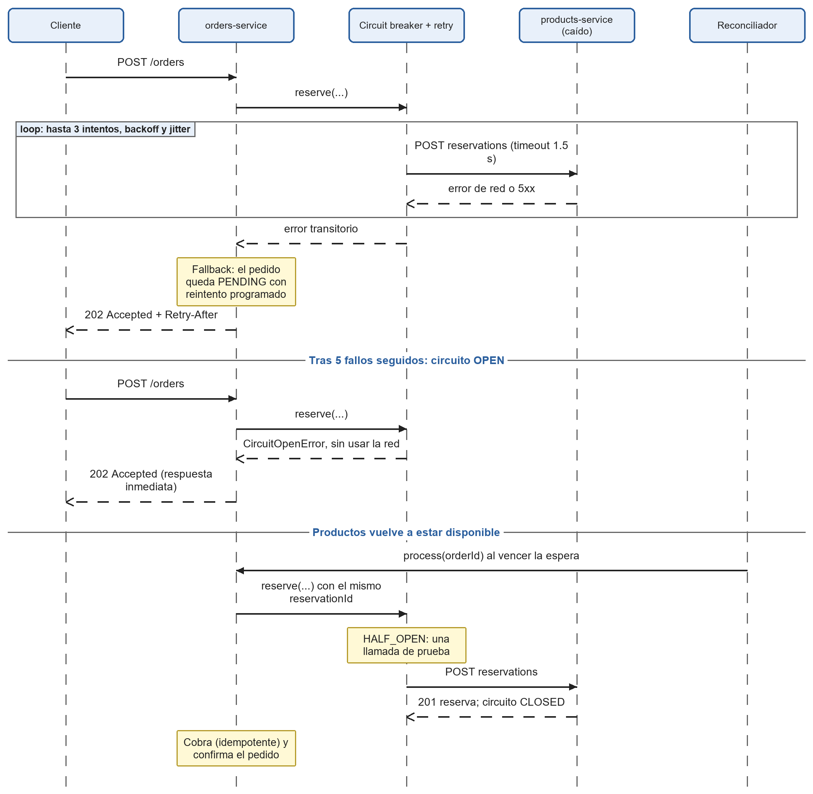
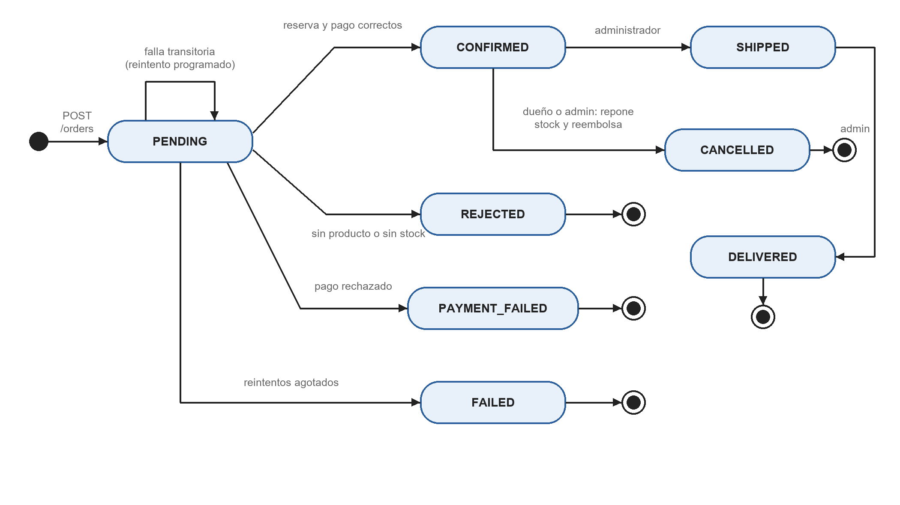
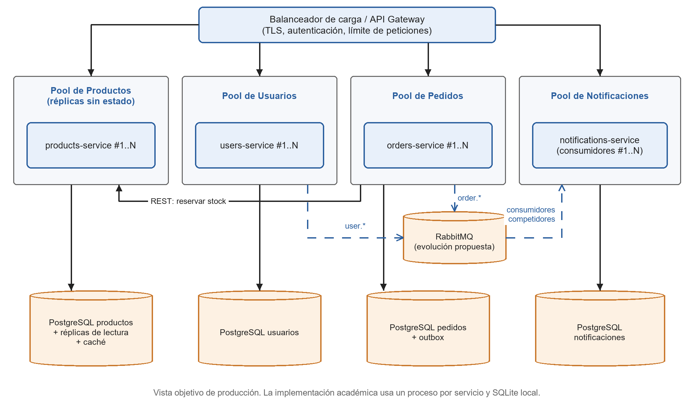

# Documentación de la arquitectura

## Visión general

Cuatro microservicios autónomos, cada uno con su proceso, su base de datos y su lógica de negocio. Internamente, cada servicio sigue tres capas: presentación (`app.js`), negocio (`service.js`) y acceso a datos (`repository.js`).

## Comunicación

| Interacción | Tipo | Mecanismo | Tratamiento de fallos |
|---|---|---|---|
| Pedidos → Productos (reservar) | Síncrona | REST | Timeout, 3 intentos con backoff y jitter, circuit breaker, fallback a PENDING |
| Pedidos → Productos (liberar) | Asíncrona | Outbox + REST | Reintentos hasta 20 veces; operación idempotente |
| Pedidos → Notificaciones | Asíncrona | Outbox + REST (202) | Reintentos; consumidor idempotente por `eventId` |
| Usuarios → Notificaciones | Asíncrona | Outbox + REST (202) | Reintentos; consumidor idempotente por `eventId` |

## Decisiones arquitectónicas

1. **Una base de datos por servicio.** Evita el acoplamiento por esquema; a cambio, las consultas entre servicios se resuelven por API y la consistencia es eventual.
2. **Saga orquestada por Pedidos.** Reservar, cobrar y confirmar con compensaciones explícitas. Se prefiere a la coreografía porque el flujo queda visible en un solo lugar.
3. **Outbox transaccional sobre HTTP en lugar de RabbitMQ.** Garantiza que el evento no se pierda si el dato se guardó, sin exigir infraestructura adicional para ejecutar el proyecto. El despachador solo depende de una función de envío por destino, por lo que migrar a RabbitMQ afecta únicamente a ese adaptador y al consumidor. Esta migración no está implementada.
4. **Reserva idempotente con `reservationId` determinista.** Permite reintentar sin descontar dos veces. Una liberación que llega antes que su reserva deja una marca para rechazar la reserva tardía.
5. **Claims en el JWT.** Pedidos obtiene el email del token y no llama a Usuarios: si Usuarios cae, se puede seguir comprando con un token vigente.
6. **Bibliotecas copiadas, no compartidas.** `lib/metrics.js` y `lib/http.js` se repiten en cada servicio. Se acepta la duplicación a cambio de despliegues independientes.
7. **Sin API Gateway en esta versión.** Evita un componente adicional y un posible punto único de fallo en un sistema académico; es la primera evolución propuesta.

## Escalabilidad horizontal

| Servicio | Estrategia | Cambios necesarios |
|---|---|---|
| Productos | Réplicas sin estado tras un balanceador | PostgreSQL con réplicas de lectura y caché del catálogo. Medido: dos instancias elevan la lectura de ≈2 580 a ≈4 400 peticiones/s en una sola máquina |
| Usuarios | Réplicas sin estado; el JWT evita sesiones en servidor | PostgreSQL; scrypt consume CPU, conviene dimensionar por CPU y limitar intentos de login |
| Pedidos | Réplicas; la idempotencia hace segura la concurrencia | PostgreSQL; `FOR UPDATE SKIP LOCKED` en despachador y reconciliador; estado de la pasarela fuera de memoria; circuit breaker por instancia |
| Notificaciones | Consumidores competidores | Broker o `SKIP LOCKED` para repartir el trabajo sin duplicar envíos |

## Puntos de extensión

Agregar un canal de notificación (SMS, push) implica un nuevo adaptador con la función `send`. Agregar un tipo de evento implica una plantilla en `notifications-service/src/service.js`. Cambiar de pasarela de pago implica un adaptador con `charge` y `refund`.
